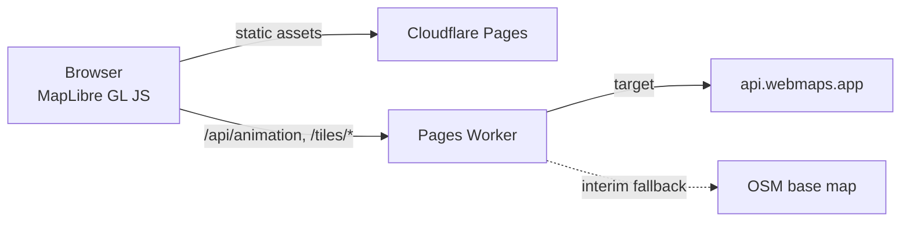

# Business Finder: Product Requirements Document

**Status:** Working draft · **Owner:** Yahaay IT Consultancy · **Last updated:** 25 Oct 2026 (rev 3)

## 1. Overview

Business Finder is a map-based business discovery tool for Philippine LGUs (local government units). It shows local businesses on an interactive map with animated transitions. When a view opens, the map flies from a wide view (city or municipality) to the barangay and then lands on the business's pin. The aim is a memorable, low-friction way for residents and visitors to find local businesses, and for LGUs to promote them.

### Goals
- Map-based discovery of local businesses within an LGU.
- Smooth, consistent animated map interactions (wide view, then barangay, then the business pin).
- Works out of the box, embeddable on LGU and business pages.
- No per-view map billing.

### Non-goals (v1)
- Turn-by-turn routing. A "Get directions" link to an external maps app is enough.
- Business self-service accounts and payments.
- Pricing (deferred, see section 8).
- Our own geocoding service.

## 2. Tech stack

| Layer | Choice | Why |
|---|---|---|
| Map rendering | **MapLibre GL JS** | Open source, vector tiles, smooth `flyTo` camera animation, no licence or per-view fees |
| Frontend hosting | **Cloudflare Pages** | The fit for a UI-heavy static site: serves the MapLibre bundle and assets from the edge. A Worker on its own is not the right host for the UI. |
| Middle layer | **Lean Cloudflare Worker** (Pages Functions) | Sits between the browser and the tile backend, holds the animation logic, and proxies tile requests |
| Tile source (target) | **api.webmaps.app** | Our own infrastructure (El owns webmaps.app), so no per-view billing |
| Tile source (interim) | **OSM-based default base map** | Makes the map work out of the box while api.webmaps.app tiles are being fixed (see 3.3) |

## 3. Architecture

### 3.1 Request flow



1. The browser loads the static MapLibre bundle from Pages.
2. The browser talks **only** to the Pages Worker. It never calls api.webmaps.app or any other tile provider directly.
3. The Worker returns the map style and the animation plan (camera keyframes, timings, and the barangay and business context) for the requested business or view.
4. The browser's tile requests go to the Worker's `/tiles/*` routes. The Worker proxies them to the active tile source and caches them at the edge.

### 3.2 Responsibilities

- **Browser (kept simple):** renders the map, plays the animation plan it receives, and handles user interaction. It holds no tile-source URLs or animation rules.
- **Worker (kept lean):** owns the animation logic and state (which views to fly through, zoom levels, durations, easing, reduced-motion behaviour) and orchestrates tile requests. It serves the style JSON with tile URLs that point back at itself. It contains minimal logic beyond that: no database in v1 and no heavy compute.
- **Pages:** serves the static bundle only.

**Why this split:** the client stays simple, and the animation logic is centralised, so it can change without redeploying the frontend. The tile source can also change (from interim to api.webmaps.app, or later providers) without touching the client.

### 3.3 Interim base map fallback

While api.webmaps.app tiles are still being fixed, the Worker serves a **default OSM base map**, so the map works out of the box.

- **Default:** a free OSM vector style, for example [OpenFreeMap](https://openfreemap.org/), which needs no API key and fits the MapLibre vector pipeline. Alternative: OpenStreetMap standard raster tiles. If raster tiles are used, the Worker must follow the [OSM tile usage policy](https://operations.osmfoundation.org/policies/tiles/): edge caching, a valid User-Agent, and no bulk or heavy use. Either way, the OSM attribution must stay visible.
- **Swappable by config:** the tile source is one Worker setting (for example `TILE_SOURCE=osm | webmaps`, with each source's URL in its own variable). Switching changes the style JSON and the proxy target only. The browser and the animation logic are unaffected.
- **Target stays api.webmaps.app.** Once its tiles are fixed and verified, flip the setting. Keep the OSM source as an emergency fallback if api.webmaps.app is unavailable.

## 4. Key design rationale

- **Own-infrastructure tiles:** serving tiles through api.webmaps.app avoids per-view Google Maps billing, so costs stay flat as usage grows.
- **Lean Worker:** minimal logic in the Worker, with Pages serving the static MapLibre bundle. That makes it cheap to run and simple to reason about.
- **Server-side animation logic:** camera sequences are defined in the Worker, so the motion can be tuned per LGU or business, or globally, without a frontend release.
- **Single tile gateway:** because every tile goes through the Worker, sources can be swapped (interim OSM, then api.webmaps.app), cached, and given access controls, all invisible to the client.

## 5. Embed spec (what a client website sees)

The client website only adds an embed tag, the same way it would embed Google Maps. Everything else happens behind the tag: the Worker renders the map, runs the animation, and streams the result into the embed. The client page contains no map or animation code, and this spec defines no client-side animation code. It describes the embed from the outside only.

### 5.1 The tag

Two equivalent forms. Both resolve to the same hosted view.

Iframe (works anywhere HTML is allowed, including Wix, Squarespace and WordPress):

```html
<iframe src="https://<embed-host>/embed?lat=-33.7290&lng=151.0790&name=Your%20Business"
        width="100%" height="400" style="border:0" loading="lazy"
        title="Business location map" allowfullscreen></iframe>
```

Script tag (a convenience wrapper that injects the same iframe):

```html
<script src="https://<embed-host>/embed.js" async></script>
<div class="business-finder"
     data-lat="-33.7290" data-lng="151.0790"
     data-name="Your Business"></div>
```

`<embed-host>` is a placeholder until the product domain is decided.

### 5.2 Parameters

| Parameter | Required | Description |
|---|---|---|
| `lat`, `lng` | Yes | The business location in decimal degrees (WGS84) |
| `name` | No | The business name, shown as the step 3 label and on the marker |
| `street` | No | Override for the street label (step 4). Otherwise the Worker derives it from the coordinates |
| `lgu` | No | Override for the LGU or council label (step 2). Otherwise it's derived from boundaries |
| `landmarks` | No | `true` (default) shows the nearby-landmarks control. `false` hides it |
| `autoplay` | No | `true` (default) plays on load. `false` shows the final view with a play button |
| `height` | No | Script-tag form only. Iframe height (default 400px) |

Unknown parameters are ignored. Invalid or missing `lat` or `lng` shows a neutral "location unavailable" state instead of a broken map. Later extras (marker colour, speed, start view, a directions button toggle) are added as optional parameters without breaking existing tags.

### 5.3 What the visitor sees

1. A map panel that fits the embed's width and height, with a light loading state while the first frame is prepared.
2. When the embed scrolls into view, the phase 1 animation plays (section 6), with labels appearing at each step.
   After it ends, the replay button and the "Nearby" landmarks toggle are available (section 5.4).
3. It ends on the business pin with the business name and street visible, plus a "Get directions" link that opens the visitor's maps app.
4. After the animation the map is interactive (pan and zoom with cooperative gestures, so page scrolling isn't hijacked).
5. If the visitor prefers reduced motion, the embed shows the final view straight away.
6. Map attribution is always visible.

### 5.4 Embed UI

The embed is a small map app, not a bare map. Its purpose is to help visitors to the business website find the business, with extra context about the neighbourhood around it. The phase 1 UI has two controls on top of the map, plus the directions link.

**Replay button**
- An always-available control (corner of the map, with an icon and an accessible label, "Replay") that re-runs the full animation sequence from section 6.
- Under reduced motion it resets to the final view instead of animating.

**Nearby landmarks (one click)**
- A single "Nearby" toggle shows a landmarks layer around the business location. Landmarks include train stations and bus interchanges, shopping centres, parks, schools, hospitals, and other well-known places, within a set radius (initially about 1 km, tunable by the Worker).
- Each landmark shows as an icon and a short name. Clicking one shows its name, its type, and its approximate distance and walking direction from the business (for example "Thornleigh Station, 450 m north"), so visitors can orient themselves ("we're near X").
- The business pin stays visually dominant. Landmarks are secondary and don't clutter the animation: they appear only after the animation ends, or when the visitor turns them on.
- The Worker chooses and ranks the landmarks (how many, which types, the radius) and serves them with the plan, so selection rules can change without changing client websites.

**Directions:** the "Get directions" link opens the visitor's maps app at the business location (section 5.3).

### 5.5 Behind the tag (for context, not part of the client contract)

The Worker decides the camera steps, timings and labels, renders or streams the map view, and proxies tiles from the active tile source (section 3.3). The browser inside the iframe only displays what the Worker sends. All of this can change without any change to client websites.

## 6. Animation sequence (phase 1)

The camera moves from wide to close in three steps, slowly and smoothly, with on-screen labels appearing in sequence as each step is reached. Timings are first-pass targets to tune.

| Step | Camera focus | Label that appears | Target timing |
|---|---|---|---|
| 1. State overview | The whole state, centred toward the location | **State name and abbreviation**, for example "New South Wales (NSW)" | Hold about 1.5 s |
| 2. LGU or council | Slow move into the LGU (council or shire) containing the location, framed to its boundary | **LGU name**, for example "Hornsby Shire" | Fly about 2.5 s, hold about 1 s |
| 3. Location area | Move into the street-level area around the business; the pin drops | **Business name**, for example "Your Business" | Fly about 2.5 s |
| 4. Final detail | Settle on the pin (same view as step 3) | **Street name**, for example "Pennant Hills Road" | Appears about 0.5 s after the business name |

Rules:
- Each label fades in when its step is reached. Earlier labels fade out or shrink into a small breadcrumb (state, then LGU) so the screen doesn't get cluttered.
- The state, LGU and street are derived by the Worker from the coordinates using boundary and street data. The `lgu` and `street` parameters override them. If a value can't be determined, that label is skipped and the animation still plays.
- The total runtime is about 7 to 9 s. Under reduced motion it jumps to the final view with the business name and street shown.
- Later phases (not in scope now) may add a city or suburb step, custom start views and branded label styles.

## 7. Functional requirements (v1)

- Load a map for an LGU and show its businesses as pins.
- The phase 1 animated sequence (section 6): state overview, then the LGU or council, then the location area, with labels in sequence. It starts when the map is visible, with a replay control.
- Respect `prefers-reduced-motion` by jumping straight to the pin.
- A marker popup with the business name and a "Get directions" link to an external maps app.
- Embeddable on third-party pages through the embed tag defined in section 5.
- Embed UI: a replay button, and a one-click nearby-landmarks layer showing the name, type, distance and direction of each landmark (section 5.4).
- Map attribution is always visible.

## 8. Open questions and next steps

- **api.webmaps.app tile fix (in progress):** the tiles are being fixed now, so the OSM fallback (3.3) is in place until then. We need El's confirmation of when it's ready and the acceptance checks before switching the default.
- **Tile API access patterns:** endpoint shape (XYZ vector, raster, or PMTiles), the style JSON, auth (a Worker-held key, never exposed to the client), rate limits, and cache headers.
- **Animation spec:** exact zoom levels per step, durations, easing, how barangay and LGU extents are found (from boundaries or fixed zooms), and per-LGU overrides.
- **LGU data sources:** where the business listings come from (LGU business permits, DTI/BNRS, manual entry), the format and update cadence, and PSGC codes for LGUs and barangays. Data-privacy (RA 10173) considerations for any personal data.
- **Boundaries:** the source for barangay and LGU boundaries (for example via api.gis.ph) used for framing and labels.
- **Embed delivery:** confirm how the Worker "streams the result" into the embed, for example a Worker-served iframe page fed its style, tiles and step plan, compared with pre-rendered video or frames. This affects interactivity after the animation and the load on the Worker.
- **Embed host and domain:** the final `<embed-host>`, and whether per-site IDs or a domain allowlist are needed.
- **Animation data:** the sources for state, LGU and street labels (boundaries and street names), and how the state abbreviation is shown.
- **Landmark data:** the source for nearby landmarks (OpenStreetMap points of interest, cached by the Worker rather than queried live per view; or later api.webmaps.app or api.gis.ph), the categories and their ranking, the radius, and how far landmarks can be tuned per business.
- **Pricing (deferred):** parked for now. El doesn't expect to price embeds, so no billing or customer-key work is planned.
- **Scope check:** the current README describes local businesses in northern Sydney, but this PRD targets Philippine LGUs. Confirm the primary market, or whether both are in scope.
- **Next steps:** (1) Worker scaffold with the OSM fallback and the animation endpoint; (2) a demo page for one pilot LGU; (3) switch to api.webmaps.app when ready; (4) update the README to match this PRD.
