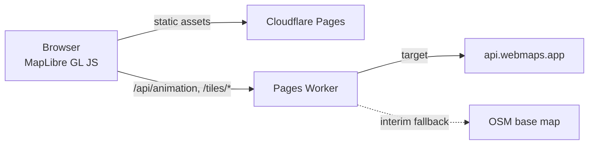

# Business Finder: Product Requirements Document

**Status:** Working draft · **Owner:** Yahaay IT Consultancy · **Last updated:** 25 Oct 2026 (rev 8)

## 1. Overview

Business Finder is a map-based business discovery tool for Philippine LGUs (local government units). It shows local businesses on an interactive map with animated transitions. When a view opens, the map flies from a wide view (city or municipality) to the barangay and then lands on the business's pin. The aim is a memorable, low-friction way for residents and visitors to find local businesses, and for LGUs to promote them.

### Goals
- Map-based discovery of local businesses within an LGU.
- Smooth, consistent animated map interactions (wide view, then barangay, then the business pin).
- Works out of the box, embeddable on LGU and business pages.
- No per-view map billing.

### Non-goals (v1)
- Turn-by-turn routing. A "Get directions" link to an external maps app is enough.
- Business self-service accounts and payments.
- Pricing (deferred, see section 10).
- Our own geocoding service.

## 2. Tech stack

| Layer | Choice | Why |
|---|---|---|
| Map rendering | **MapLibre GL JS** | Open source, vector tiles, smooth `flyTo` camera animation, no licence or per-view fees |
| Frontend hosting | **Cloudflare Pages** | The fit for a UI-heavy static site: serves the MapLibre bundle and assets from the edge. A Worker on its own is not the right host for the UI. |
| Middle layer | **Lean Cloudflare Worker** (Pages Functions) | Sits between the browser and the tile backend, holds the animation logic, and proxies tile requests |
| Tile source (target) | **api.webmaps.app** | Our own infrastructure (El owns webmaps.app), so no per-view billing |
| Tile source (interim) | **OSM-based default base map** | Makes the map work out of the box while api.webmaps.app tiles are being fixed (see 3.3) |

## 3. Architecture

### 3.1 Request flow



1. The browser loads the static MapLibre bundle from Pages.
2. The browser talks **only** to the Pages Worker. It never calls api.webmaps.app or any other tile provider directly.
3. The Worker returns the map style and the animation plan (camera keyframes, timings, and the barangay and business context) for the requested business or view.
4. The browser's tile requests go to the Worker's `/tiles/*` routes. The Worker proxies them to the active tile source and caches them at the edge.

### 3.2 Responsibilities

- **Browser (kept simple):** renders the map, plays the animation plan it receives, and handles user interaction. It holds no tile-source URLs or animation rules.
- **Worker (kept lean):** owns the animation logic and state (which views to fly through, zoom levels, durations, easing, reduced-motion behaviour) and orchestrates tile requests. It serves the style JSON with tile URLs that point back at itself. It contains minimal logic beyond that: no database in v1 and no heavy compute.
- **Pages:** serves the static bundle only.

**Why this split:** the client stays simple, and the animation logic is centralised, so it can change without redeploying the frontend. The tile source can also change (from interim to api.webmaps.app, or later providers) without touching the client.

### 3.3 Interim base map fallback

While api.webmaps.app tiles are still being fixed, the Worker serves a **default OSM base map**, so the map works out of the box.

- **Default:** a free OSM vector style, for example [OpenFreeMap](https://openfreemap.org/), which needs no API key and fits the MapLibre vector pipeline. Alternative: OpenStreetMap standard raster tiles. If raster tiles are used, the Worker must follow the [OSM tile usage policy](https://operations.osmfoundation.org/policies/tiles/): edge caching, a valid User-Agent, and no bulk or heavy use. Either way, the OSM attribution must stay visible.
- **Swappable by config:** the tile source is one Worker setting (for example `TILE_SOURCE=osm | webmaps`, with each source's URL in its own variable). Switching changes the style JSON and the proxy target only. The browser and the animation logic are unaffected.
- **Target stays api.webmaps.app.** Once its tiles are fixed and verified, flip the setting. Keep the OSM source as an emergency fallback if api.webmaps.app is unavailable.

## 4. Key design rationale

- **Own-infrastructure tiles:** serving tiles through api.webmaps.app avoids per-view Google Maps billing, so costs stay flat as usage grows.
- **Lean Worker:** minimal logic in the Worker, with Pages serving the static MapLibre bundle. That makes it cheap to run and simple to reason about.
- **Server-side animation logic:** camera sequences are defined in the Worker, so the motion can be tuned per LGU or business, or globally, without a frontend release.
- **Single tile gateway:** because every tile goes through the Worker, sources can be swapped (interim OSM, then api.webmaps.app), cached, and given access controls, all invisible to the client.

## 5. Embed spec (what a client website sees)

The client website only adds an embed tag, the same way it would embed Google Maps. Everything else happens behind the tag: the Worker renders the map, runs the animation, and streams the result into the embed. The client page contains no map or animation code, and this spec defines no client-side animation code. It describes the embed from the outside only.

### 5.1 The tag

Two equivalent forms. Both resolve to the same hosted view. The tag carries **only a short business ID**, created in the self-serve onboarding flow (section 7). Everything else (location, name, labels, options) is stored server-side and looked up by the Worker, so the tag stays clean, like Google Maps' embed code, and never needs to change when the owner updates their details.

Iframe (works anywhere HTML is allowed, including Wix, Squarespace and WordPress):

```html
<iframe src="https://goto.yahaay.com/e/bf_7Kq2xR9"
        width="100%" height="400" style="border:0" loading="lazy"
        title="Business location map" allowfullscreen></iframe>
```

Script tag (a convenience wrapper that injects the same iframe):

```html
<script src="https://goto.yahaay.com/embed.js" async></script>
<div class="business-finder" data-id="bf_7Kq2xR9"></div>
```

The embed/worker host is **`https://goto.yahaay.com`**, configured as `EMBED_HOST` in `wrangler.toml` and served to pages by `GET /api/config`. The DNS and custom domain aren't set up yet (section 10).

### 5.2 Parameters

**Public tag parameters:** only the business ID (path segment `/e/<id>` or `data-id`) and, for the script tag, an optional `data-height`. An unknown or disabled ID shows the neutral "location unavailable" state.

**Stored configuration (server-side, not in the tag):** the fields below are held in the business config (section 8) and edited through onboarding. They're listed for reference. The raw query-parameter form (`/embed?lat=&lng=&name=...`) stays available for development and the demo only, and isn't offered to customers.

| Parameter | Required | Description |
|---|---|---|
| `lat`, `lng` | Yes | The business location in decimal degrees (WGS84) |
| `name` | No | The business name, shown as the step 3 label and on the marker |
| `street` | No | Override for the street label (step 4). Otherwise the Worker derives it from the coordinates |
| `lgu` | No | Override for the LGU or council label (step 2). Otherwise it's derived from boundaries |
| `landmarks` | No | `true` (default) shows the nearby-landmarks control. `false` hides it |
| `autoplay` | No | `true` (default) plays on load. `false` shows the final view with a play button |
| `height` | No | Script-tag form only. Iframe height (default 400px) |

Unknown parameters are ignored. Invalid or missing `lat` or `lng` shows a neutral "location unavailable" state instead of a broken map. Later extras (marker colour, speed, start view, a directions button toggle) are added as optional parameters without breaking existing tags.

### 5.3 What the visitor sees

1. A map panel that fits the embed's width and height, with a light loading state while the first frame is prepared.
2. When the embed scrolls into view, the phase 1 animation plays (section 6), with labels appearing at each step.
   After it ends, the replay button and the "Nearby" landmarks toggle are available (section 5.4).
3. It ends with a slow drone-style orbit: the map tilts and circles the business pin, which stays fixed in the centre. It then settles on the pin with the business name and street visible, plus a "Get directions" link that opens the visitor's maps app. The map then keeps gently pulsing between the council (shire) view and the business, with a short orbit each time, until the visitor interacts (section 6.1).
4. After the animation the map is interactive (pan and zoom with cooperative gestures, so page scrolling isn't hijacked).
5. If the visitor prefers reduced motion, the embed shows the final view straight away.
6. Map attribution is always visible.

### 5.4 Embed UI

The embed is a small map app, not a bare map. Its purpose is to help visitors to the business website find the business, with extra context about the neighbourhood around it. The phase 1 UI has two controls on top of the map, plus the directions link.

**Replay button**
- An always-available control (corner of the map, with an icon and an accessible label, "Replay") that re-runs the full animation sequence from section 6.
- Under reduced motion it resets to the final view instead of animating.

**Nearby landmarks (one click)**
- A single "Nearby" toggle shows a landmarks layer around the business location. Landmarks include train stations and bus interchanges, shopping centres, parks, schools, hospitals, and other well-known places, within a set radius (initially about 1 km, tunable by the Worker).
- Each landmark shows as an icon and a short name. Clicking one shows its name, its type, and its approximate distance and walking direction from the business (for example "Thornleigh Station, 450 m north"), so visitors can orient themselves ("we're near X").
- The business pin stays visually dominant. Landmarks are secondary and don't clutter the animation: they don't appear during the fly-in (steps 1 to 4). They switch on automatically when the drone orbit (section 6, step 5) starts, so they're visible while the camera circles the business, and the "Nearby" toggle shows as on. They stay on afterwards, and the visitor can turn them off or on with the toggle.
- The Worker chooses and ranks the landmarks (how many, which types, the radius) and serves them with the plan, so selection rules can change without changing client websites.

**Directions:** the "Get directions" link opens the visitor's maps app at the business location (section 5.3).

### 5.5 Behind the tag (for context, not part of the client contract)

The Worker decides the camera steps, timings and labels, renders or streams the map view, and proxies tiles from the active tile source (section 3.3). The browser inside the iframe only displays what the Worker sends. All of this can change without any change to client websites.

## 6. Animation sequence (phase 1)

The camera moves from wide to close in three steps, slowly and smoothly, with on-screen labels appearing in sequence as each step is reached. Timings are first-pass targets to tune.

| Step | Camera focus | Label that appears | Target timing |
|---|---|---|---|
| 1. State overview | The whole state, centred toward the location | **State name and abbreviation**, for example "New South Wales (NSW)" | Hold about 2.5 s |
| 2. LGU or council | Slow move into the LGU (council or shire) containing the location, framed to its boundary | **LGU name**, for example "Hornsby Shire" | Fly about 4.5 s, hold about 1.5 s |
| 3. Location area | Move into the street-level area around the business; the pin drops | **Business name**, for example "Your Business" | Fly about 4.5 s |
| 4. Final detail | Settle on the pin (same view as step 3) | **Street name**, for example "Pennant Hills Road" | Appears about 1 s after the business name |
| 5. Drone orbit | The camera eases one zoom level closer than step 3 while the map tilts (pitch to about 58°), then slowly orbits the business (bearing sweeps about 180°), with the centre locked on the pin. It then eases back to about 45° pitch | No new label. The business name and street stay visible. Nearby landmarks switch on as the orbit starts | Orbit about 17 s, including a 3 s zoom and pitch ease-in; settle about 2 s |

Rules:
- Each label fades in when its step is reached. Earlier labels fade out or shrink into a small breadcrumb (state, then LGU) so the screen doesn't get cluttered.
- The state, LGU and street are derived by the Worker from the coordinates using boundary and street data. The `lgu` and `street` parameters override them. If a value can't be determined, that label is skipped and the animation still plays.
- **Drone orbit (step 5):** the centre stays locked exactly on the business pin for the whole move, and only zoom, pitch and bearing change, so the pin never drifts. The orbit starts one zoom level closer than the location step, eased in smoothly together with the tilt. The Worker's plan sets the zoom (location zoom + 1), pitch (about 58°), bearing sweep (about 180°), duration (about 17 s), easing (gentle ease-in-out) and settle pitch (about 45°). The player only executes them.
- **Landmarks during the orbit:** the Nearby landmarks layer turns on automatically when the orbit starts (the toggle shows as pressed) and stays on afterwards (see 5.4).
- Under reduced motion the orbit is skipped. Any user interaction (drag, zoom, wheel or touch) stops the orbit immediately. Replay re-runs the whole sequence, including the orbit.
- The replay button, the "Nearby" toggle and the directions link appear once the orbit settles.
- Every step uses gentle ease-in-out easing. Steps 1 to 4 run about 14 s, plus about 19 s for the orbit and settle. After that, the local suburb loop in 6.1 runs until the visitor interacts. Under reduced motion it jumps to the final view with the business name and street shown.
### 6.1 Loop (after the first pass)

The state overview and the LGU or shire view play **once**, at the start. After the first full pass (steps 1 to 5), the embed loops with a local pull-back around the business, indefinitely:

| Loop step | Camera | Labels | Target timing |
|---|---|---|---|
| A. Local pull-back | Slow zoom out to suburb scale, centred on the business (about 2.5 zoom levels out from the location view, about zoom 13.5; flat, north up). The pin stays in view. | **Business name** and **street name** stay visible | Fly about 4.5 s, hold about 3.5 s |
| B. Back to the location | Slow zoom back in to the business | **Business name** and **street name** | Fly about 4.5 s |
| C. Short orbit | A shorter drone orbit (about 90° over about 8 s, then settle about 1.5 s) with the same rules as step 5: centre locked on the pin, one zoom level closer, Nearby landmarks on | Business and street stay visible | About 10 s, then hold about 1.5 s and repeat from A |

Rules:
- Neither the state view nor the LGU or shire view is part of the loop. The pull-back stays within the suburb so the visitor keeps the local context (nearby streets and landmarks) without leaving the area.
- **The orbit repeats in each loop, shortened.** A short orbit keeps the location beat lively without the full 17 s move every cycle.
- The loop parameters (steps, the pull-back zoom, fly and hold times, the short orbit, and whether it repeats) come from the Worker plan (`plan.loop`). The player only executes them.
- Nearby landmarks stay on through the loop.
- Any user interaction stops the sequence and the loop immediately and leaves the map where it is. That covers drag, zoom, wheel, touch, or clicking a landmark, the pin or a popup.
- Replay restarts from the state overview (step 1). Under reduced motion there is no animation and no loop.

- Later phases (not in scope now) may add a city or suburb step, custom start views and branded label styles.

## 7. Self-serve onboarding

Business owners set up their own embed on a Business Finder web page. No account manager or map skills needed.

### 7.1 Flow

1. **Start:** the owner opens the onboarding page (the onboarding section `#start` of the landing page at `https://www.yahaay.com/business-finder/`; see 7.4).
2. **Enter address:** they type their business address and press Search (a submitted search, not suggestions while typing; see 7.3).
3. **Geocode and confirm:** the Worker geocodes the address through **Nominatim** (OpenStreetMap's geocoding service) and the page shows the result: the formatted address plus a pin on a small map preview. If there are several matches, the owner picks one. They confirm the pin or drag it to the exact entrance. The **owner-confirmed lat/lng** is what gets saved to D1.
4. **Customise:** they enter what they want shown. That covers the display business name (which can differ from the legal or OSM name), the street label override, optional LGU or council label override, phone, website, opening-hours note, a short tagline, and toggles (show Nearby landmarks, autoplay).
5. **Preview:** a live preview of the embed plays the real animation with their details.
6. **Get the code:** the page issues a short business ID and shows the copy-paste iframe and script tags (section 5.1), which contain only that ID.
7. **Manage later:** the owner receives a private edit link by email (a magic link, no password) to update their details anytime. Changes apply to the live embed immediately (within the Worker cache lifetime) **without touching the tag**.

### 7.2 Rules

- The business ID is short, random and non-sequential (e.g. `bf_` plus 8 to 10 base62 characters). It's safe to show publicly and reveals nothing about the business.
- Editing is protected by a separate secret edit token, delivered by the magic link and stored hashed. The public ID alone never grants edit access.
- No Google services are used anywhere in onboarding or the map, and we store no Google Places data. Address lookup is Nominatim (7.3). The stored location is the owner-confirmed pin, which is our own data.
- Basic abuse controls: rate-limit onboarding, email verification before an embed goes live, and the ability to disable an ID.
- No pricing or billing in this flow (deferred).

### 7.3 Address lookup: Nominatim

- **Service:** Nominatim, OpenStreetMap's geocoder (`/search?format=jsonv2&q=<address>&countrycodes=au&limit=5&addressdetails=1`). It's free, needs no API key, and the results come from OSM data under the ODbL licence. That means we can store the resulting coordinates long-term, with OSM attribution. This avoids Google Maps Platform's limits on storing Places content.
- **Server-side only:** the browser never calls Nominatim directly. The onboarding page calls a Worker endpoint (e.g. `POST /api/geocode`), which calls Nominatim, in keeping with "the browser talks only to the Worker".
- **Usage policy (public instance):** at most 1 request per second, a real identifying User-Agent (or Referer) with a contact email, cached results, and **no autocomplete-as-you-type**. That's why step 2 is a submitted search. The Worker rate-limits and caches geocode calls (e.g. by normalised address) to stay within this.
- **Flow into storage:** address, then Nominatim results, then the owner picks one and confirms or adjusts the pin, then the Worker saves `address`, `lat`, `lng` (the owner-confirmed values) and the OSM reference (`osm_type`/`osm_id`) to D1.
- **Fallback and growth:** if volume outgrows the public instance, swap to a self-hosted Nominatim or a commercial Nominatim-compatible host behind the same Worker endpoint, with no change to the onboarding page. An Australian address source (G-NAF) is an option if match quality on new or rural addresses is weak.

### 7.4 Product, landing page and hosting

- **Business Finder is a yahaay.com product.** Its public page, combining the landing content and the self-serve onboarding flow, is a **single page at `yahaay.com/business-finder/`**. The onboarding is a section of that page (`#start`), not a separate route. It lives in the **YahaayLabs/yahaay.com** repo (`public/business-finder/index.html`), not in this repo.
- **The landing page:** a hero with a live demo embed, how it works in 3 steps, features, an embed code sample, an FAQ, and the onboarding flow. No pricing, testimonials or stats.
- **The worker/embed service is `https://goto.yahaay.com`** (this repo). The landing page talks only to it: the demo iframe (`/embed`), geocoding (`POST /api/geocode`) and the generated tags. The page keeps that base URL in one constant, with a `?api=` override for local testing.
- **CORS:** `/api/*` answers CORS for `https://yahaay.com`, `https://www.yahaay.com` and the local dev origins (`http://100.70.42.126:8789`, `http://192.168.8.26:8789`, `localhost:8789`), including the OPTIONS preflight (`functions/_middleware.ts`; overridable with `CORS_ORIGINS`). Tiles and the style are already served with `access-control-allow-origin: *`.
- **Framing:** `/embed` and `/e/*` send `Content-Security-Policy: frame-ancestors *` and no `X-Frame-Options`, because embedding on any site is the product (yahaay.com included).
- **Brand decisions (user, 25 Oct 2026):** (1) indigo **#4f46e5** is approved as the Yahaay accent (hover #4338ca, pressed #3730a3; #a5b4fc for links and focus on dark), per the Designer's colour guide; the embed controls, pin and landmark pills use it. (2) Embeds **show a small "by Yahaay" credit** inside the map attribution row, linking to `https://www.yahaay.com/business-finder/` (new tab), hidden below 240 px height.

## 8. Storage

### 8.1 Choice: Cloudflare D1 (for now)

Business configs are stored in **Cloudflare D1**, Cloudflare's SQLite-compatible SQL database, bound to the Worker. It fits the stack (same platform as Pages and the Worker, no extra servers), and plain SQL makes the schema easy to inspect and evolve while we learn what's needed. It can be revisited later (for example Postgres via api.gis.ph) if needs outgrow it.

Read path: `/e/<id>` leads the Worker to look up the config by ID (cached at the edge for a short TTL, e.g. 60 s), and then it builds the animation plan. Write path: the onboarding and edit pages call Worker endpoints that validate the input and write to D1, then purge the cache entry.

### 8.2 Schema sketch (rough, first pass)

```sql
-- One row per embeddable business.
CREATE TABLE business_config (
  id              TEXT PRIMARY KEY,          -- public short ID, e.g. 'bf_7Kq2xR9'
  business_name   TEXT NOT NULL,             -- display name chosen by the owner
  address         TEXT NOT NULL,             -- confirmed formatted address
  osm_ref         TEXT,                      -- Nominatim match, e.g. 'W123456' (osm_type + osm_id); optional
  lat             REAL NOT NULL,             -- owner-confirmed pin from Nominatim lookup (WGS84)
  lng             REAL NOT NULL,
  street_label    TEXT,                      -- optional override for step 4 label
  lgu_label       TEXT,                      -- optional override for step 2 label
  state_label     TEXT,                      -- derived, cached (e.g. 'New South Wales (NSW)')
  display_fields  TEXT NOT NULL DEFAULT '{}',-- JSON: phone, website, hours note, tagline, etc.
  options         TEXT NOT NULL DEFAULT '{}',-- JSON: landmarks on/off, autoplay, marker colour...
  owner_email     TEXT NOT NULL,             -- for magic-link edits (personal data)
  edit_token_hash TEXT NOT NULL,             -- hash of the secret edit token
  status          TEXT NOT NULL DEFAULT 'pending', -- pending | active | disabled
  created_at      TEXT NOT NULL DEFAULT (strftime('%Y-%m-%dT%H:%M:%fZ','now')),
  updated_at      TEXT NOT NULL DEFAULT (strftime('%Y-%m-%dT%H:%M:%fZ','now'))
);

CREATE INDEX idx_business_config_status ON business_config(status);
CREATE INDEX idx_business_config_email  ON business_config(owner_email);
```

Notes:
- `display_fields` and `options` are JSON text (D1 supports SQLite JSON functions), so new display fields don't need a migration while the shape is still settling. Promote stable ones to real columns later.
- Timestamps are ISO-8601 UTC strings. `updated_at` is set by the Worker on every write (or by a trigger).
- Landmarks aren't stored per business yet. They're computed and cached by the Worker. A `landmark_overrides` JSON column or table can come later.
- Schema changes go through D1 migrations (`wrangler d1 migrations`), kept in the repo.

## 9. Functional requirements (v1)

- Load a map for an LGU and show its businesses as pins.
- The phase 1 animated sequence (section 6): state overview, then the LGU or council, then the location area, with labels in sequence. It starts when the map is visible, with a replay control.
- Respect `prefers-reduced-motion` by jumping straight to the pin.
- A marker popup with the business name and a "Get directions" link to an external maps app.
- Embeddable on third-party pages through the embed tag defined in section 5.
- Embed UI: a replay button, and a one-click nearby-landmarks layer showing the name, type, distance and direction of each landmark (section 5.4).
- Self-serve onboarding: address entry, Nominatim geocoding with pin confirmation, customisation, preview, and an ID-only embed code. The owner can edit later through a magic link (section 7).
- Business configs stored in Cloudflare D1 (section 8).
- Map attribution is always visible.

## 10. Open questions and next steps

- **api.webmaps.app tile fix (in progress):** the tiles are being fixed now, so the OSM fallback (3.3) is in place until then. We need El's confirmation of when it's ready and the acceptance checks before switching the default.
- **Tile API access patterns:** endpoint shape (XYZ vector, raster, or PMTiles), the style JSON, auth (a Worker-held key, never exposed to the client), rate limits, and cache headers.
- **Animation spec:** exact zoom levels per step, durations, easing, how barangay and LGU extents are found (from boundaries or fixed zooms), and per-LGU overrides.
- **LGU data sources:** where the business listings come from (LGU business permits, DTI/BNRS, manual entry), the format and update cadence, and PSGC codes for LGUs and barangays. Data-privacy (RA 10173) considerations for any personal data.
- **Boundaries:** the source for barangay and LGU boundaries (for example via api.gis.ph) used for framing and labels.
- **Embed delivery:** confirm how the Worker "streams the result" into the embed, for example a Worker-served iframe page fed its style, tiles and step plan, compared with pre-rendered video or frames. This affects interactivity after the animation and the load on the Worker.
- **yahaay.com routing:** `/business-finder/` is served by the yahaay.com Worker as a static page. Decide whether that stays (a separate deploy calling goto.yahaay.com cross-origin, as now) or yahaay.com proxies or routes `/business-finder` to this Pages project.
- **goto.yahaay.com DNS and custom domain:** not set up yet, because nothing has been deployed. It needs a Pages custom domain (CNAME) on the yahaay.com zone.
- **Embed domain allowlist:** whether embeds should also be restricted to the owner's own domain (an allowlist on the config).
- **~~Google address matching~~ (resolved):** we use Nominatim (7.3) instead of Google, so no Google Places data is stored and the coordinate-storage concern goes away. What remains is to check Nominatim match quality on Australian addresses (new estates, unit numbers, rural addresses) and decide when to move off the public instance.
- **Owner identity and privacy:** magic-link email provider, verification before go-live, and handling of owner emails as personal data (Australian Privacy Act; RA 10173 if Philippine LGUs are in scope).
- **D1 limits and backup:** check D1 size and query limits for the expected number of businesses, and set up a backup or export routine.
- **Animation data:** the sources for state, LGU and street labels (boundaries and street names), and how the state abbreviation is shown.
- **Landmark data:** the source for nearby landmarks (OpenStreetMap points of interest, cached by the Worker rather than queried live per view; or later api.webmaps.app or api.gis.ph), the categories and their ranking, the radius, and how far landmarks can be tuned per business.
- **Pricing (deferred):** parked for now. El doesn't expect to price embeds, so no billing or customer-key work is planned.
- **Scope check:** the current README describes local businesses in northern Sydney, but this PRD targets Philippine LGUs. Confirm the primary market, or whether both are in scope.
- **Next steps:** (1) Worker scaffold with the OSM fallback and the animation endpoint; (2) a demo page for one pilot LGU; (3) switch to api.webmaps.app when ready; (4) update the README to match this PRD.
